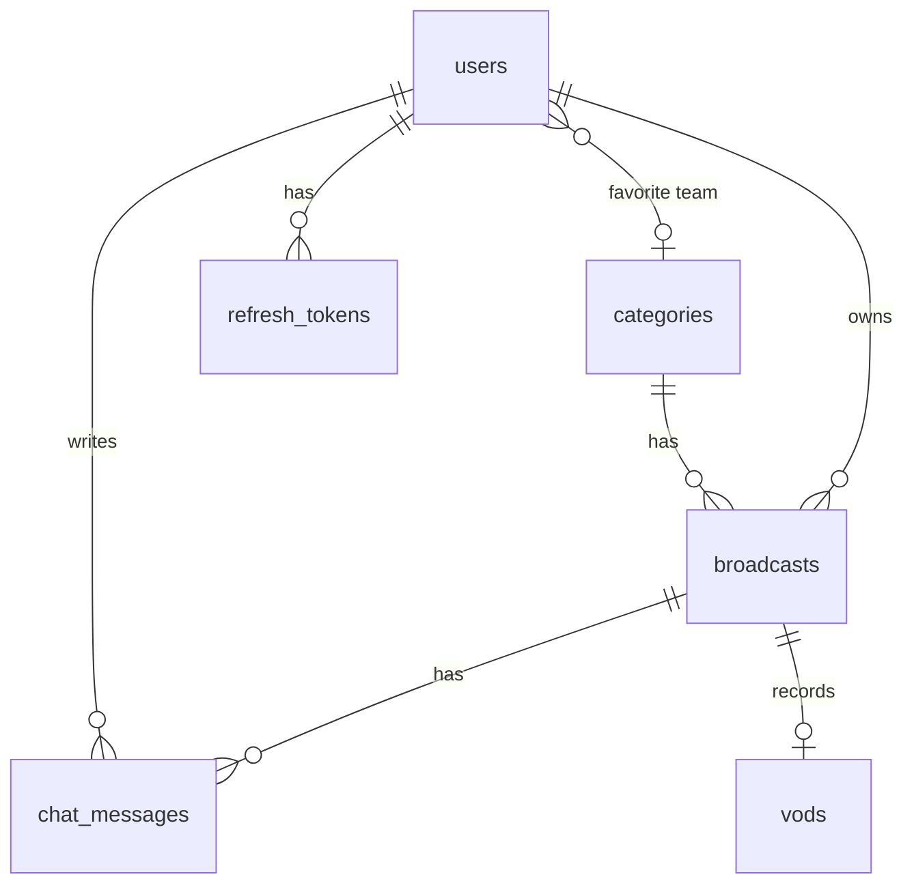
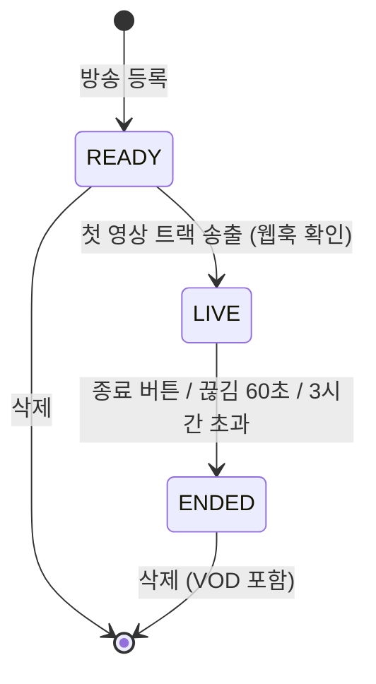

# 데이터 모델 · API · 권한

> 원본: Cowork 설계 문서(2026-11-08). 이 파일이 백엔드·프론트·QA의 공통 기준이에요.

방송은 READY → LIVE → ENDED 한 방향으로만 바뀌고, 모든 수정·삭제·송출 제어는 서버가 **소유자와 상태를 함께** 확인해요.

## 1. 데이터 모델

### users
| 컬럼 | 타입 | 설명 |
| --- | --- | --- |
| id | BIGINT PK | |
| email | VARCHAR UNIQUE | 로그인 ID |
| password_hash | VARCHAR | BCrypt |
| nickname | VARCHAR(20) UNIQUE | 표시 이름 |
| favorite_category_id | FK → categories, NULL | 내 팀 |
| is_test | BOOLEAN | 테스트 계정 여부 |
| created_at | TIMESTAMP | |

### refresh_tokens
user_id, token_hash, expires_at. 로그아웃 시 삭제.

### categories (시드 11개 고정)
| 컬럼 | 타입 | 설명 |
| --- | --- | --- |
| id | BIGINT PK | |
| code | VARCHAR UNIQUE | LG, KT, SSG, NC, DOOSAN, KIA, LOTTE, SAMSUNG, HANWHA, KIWOOM, NATIONAL |
| name | VARCHAR | 표시 이름 |
| type | ENUM | KBO_TEAM / NATIONAL |
| color | VARCHAR(7) | 팀컬러 HEX |
| sort_order | INT | 칩 정렬 순서 |

### broadcasts
| 컬럼 | 타입 | 설명 |
| --- | --- | --- |
| id | BIGINT PK | |
| owner_id | FK → users | 권한 검사 기준 |
| category_id | FK → categories | READY에서만 변경 가능 |
| title | VARCHAR(100) | 필수 |
| description | VARCHAR(1000) | 선택 |
| source_type | ENUM | PC / MOBILE |
| status | ENUM | READY / LIVE / ENDED |
| room_name | VARCHAR UNIQUE | LiveKit 방 이름 (bc-{id}-{uuid}) |
| peak_viewers | INT | 최대 동시 시청자 |
| started_at / ended_at | TIMESTAMP NULL | 상태 전이 시각 |
| created_at / updated_at | TIMESTAMP | |
| version | BIGINT | 낙관적 락 |

### chat_messages
| 컬럼 | 타입 | 설명 |
| --- | --- | --- |
| id | BIGINT PK | |
| broadcast_id | FK → broadcasts | 방송 삭제 시 함께 삭제 |
| author_id | FK → users | 수정·삭제 권한 기준 |
| content | VARCHAR(200) | |
| edited | BOOLEAN | '(수정됨)' 표시 |
| deleted_at | TIMESTAMP NULL | 소프트 삭제 |
| created_at / updated_at | TIMESTAMP | |

### vods
| 컬럼 | 타입 | 설명 |
| --- | --- | --- |
| id | BIGINT PK | |
| broadcast_id | FK UNIQUE → broadcasts | 1:1, 방송 삭제 시 S3 파일과 함께 삭제 |
| egress_id | VARCHAR | LiveKit 녹화 작업 ID |
| status | ENUM | RECORDING / READY / FAILED |
| s3_key | VARCHAR | 재생은 서명된 URL |
| duration_sec | INT | |
| created_at | TIMESTAMP | |

### donations (예약, 미구현)
broadcast_id, donor_id, amount, order_id(UNIQUE), payment_key, status, created_at. 테이블·API는 만들지 않음.

현재 시청자 수는 DB에 저장하지 않고 LiveKit 방 참가자 수를 10초 캐시해요.

## 2. 방송 상태 전이

| 상태 | 수정 | 삭제 | 시청 | 채팅 작성 |
| --- | --- | --- | --- | --- |
| READY | 모든 항목 | 가능 | 불가 | 불가 |
| LIVE | 제목·설명만 | 불가(409) | 가능 | 가능 |
| ENDED | 제목·설명만 | 가능(VOD 포함) | 다시보기 | 불가(읽기만) |

1. **송출 시작:** 소유자가 `start` → READY·소유자 확인 후 송출 토큰 발급(상태는 READY 유지)
2. **LIVE 전환:** LiveKit `track_published` 웹훅 → LIVE + started_at + 녹화 시작 + status 채널 알림
3. **정상 종료:** `end` → ENDED + ended_at, LiveKit 방 닫기
4. **비정상 종료:** `participant_left` 후 60초 안에 재접속 없으면 자동 ENDED
5. **녹화 마무리:** `egress_ended` → VOD READY, 실패 시 FAILED

같은 웹훅이 다시 와도 이미 바뀐 상태면 무시. 시작·종료 동시 요청은 version(낙관적 락)으로 하나만 성공.

## 3. API

REST는 `/api`, 실시간은 STOMP(`/ws`)로 서버가 밀어주기만 해요. 채팅 전송도 REST로 받아요.

| 메서드 | 경로 | 설명 | 접근 |
| --- | --- | --- | --- |
| POST | /api/auth/signup | 회원가입 | 공개 |
| POST | /api/auth/login | 로그인 → access token + refresh 쿠키 | 공개 |
| POST | /api/auth/test-login | 테스트 계정 로그인 (`role`: STREAMER/VIEWER) | 공개 |
| POST | /api/auth/refresh | access 재발급 | refresh 쿠키 |
| POST | /api/auth/logout | refresh 폐기 | 로그인 |
| GET | /api/auth/me | 내 정보 | 로그인 |
| GET | /api/categories | 카테고리 11개 | 공개 |
| GET | /api/broadcasts | 목록 (status, category, sort, page) | 공개 |
| GET | /api/broadcasts/{id} | 상세 | 공개 |
| POST | /api/broadcasts | 등록 (READY) | 로그인 |
| PATCH | /api/broadcasts/{id} | 수정 | 소유자 |
| DELETE | /api/broadcasts/{id} | 삭제 | 소유자 |
| GET | /api/me/broadcasts | 내 방송 목록 | 로그인 |
| POST | /api/broadcasts/{id}/start | 송출 토큰 발급 | 소유자 |
| POST | /api/broadcasts/{id}/end | 송출 종료 | 소유자 |
| POST | /api/broadcasts/{id}/viewer-token | 시청 토큰(구독 전용) | 공개 |
| GET | /api/vods | 다시보기 목록 | 공개 |
| GET | /api/vods/{id} | 다시보기 상세 + 재생 URL | 공개 |
| GET | /api/broadcasts/{id}/chats | 채팅 목록(커서) | 공개 |
| POST | /api/broadcasts/{id}/chats | 채팅 작성 | 로그인 |
| PATCH | /api/chats/{id} | 채팅 수정 | 작성자 |
| DELETE | /api/chats/{id} | 채팅 삭제 | 작성자 |
| POST | /api/webhooks/livekit | LiveKit 이벤트 | 서명 검증 |

실시간 채널(구독 공개): `/topic/broadcasts/{id}/chat`, `/topic/broadcasts/{id}/status`

공통 규칙
- 인증: `Authorization: Bearer <access>`(30분), refresh는 httpOnly 쿠키(14일), SameSite=Lax
- 에러: `{"code": "BROADCAST_NOT_OWNER", "message": "..."}` / 400 검증, 401 미인증, 403 권한 없음, 404, 409 상태 충돌, 429 제한
- 명세 원본은 springdoc이 생성하는 OpenAPI(Swagger)

## 4. 권한 표

표의 칸 하나가 인가 테스트 하나예요. 권한 검사(401·403)를 먼저, 통과하면 상태(409)를 확인해요.

| 동작 | 비로그인 | 다른 사용자 | 소유자·작성자 | 상태 조건 |
| --- | --- | --- | --- | --- |
| 방송 목록·상세 | 허용 | 허용 | 허용 | 없음 |
| 라이브 시청(viewer-token) | 허용 | 허용 | 허용 | LIVE 아니면 409 |
| 다시보기 조회·재생 | 허용 | 허용 | 허용 | VOD가 READY 아니면 404 |
| 방송 등록 | 401 | 허용 | 허용 | 없음 |
| 방송 수정 | 401 | 403 | 허용 | LIVE·ENDED에서 카테고리·송출 방식 변경 시 409 |
| 방송 삭제 | 401 | 403 | 허용 | LIVE면 409 |
| 송출 시작 | 401 | 403 | 허용 | READY 아니면 409 |
| 송출 종료 | 401 | 403 | 허용 | LIVE 아니면 409 |
| 내 방송 목록 | 401 | 본인 것만 | 본인 것만 | 없음 |
| 채팅 목록·구독 | 허용 | 허용 | 허용 | 없음 |
| 채팅 작성 | 401 | 허용 | 허용 | LIVE 아니면 409 |
| 채팅 수정·삭제 | 401 | 403 | 허용 | 삭제된 메시지면 409 |
| LiveKit 웹훅 | 서명 없으면 401 | — | — | 같은 이벤트 재수신 시 무시 |

- 소유자 판단은 토큰의 사용자 ID와 owner_id 비교로만. 프론트에서 버튼을 숨겨도 서버가 항상 다시 확인
- LiveKit 송출 토큰은 소유자에게만(publish), 시청 토큰은 구독 전용

## 5. 확장 포인트

- 후원: `POST /api/broadcasts/{id}/donations/prepare` → 토스 결제 → `POST /api/donations/confirm`, order_id UNIQUE로 중복 방지, 채팅 메시지 타입 CHAT/DONATION
- 방송 소유자의 채팅 관리
