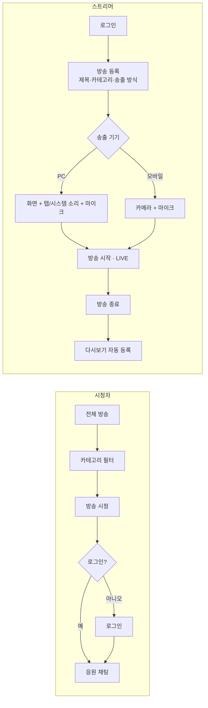

# 화면 구성 & 사용자 흐름

> 원본: Cowork 설계 문서(2026-11-08). 이 파일이 구현 기준이에요. 바뀌면 여기를 먼저 고쳐요.

## 컨셉

- 서비스명: **덕아웃(Dugout)** — 야구 팬 스트리머의 라이브 방송 플랫폼
- 카테고리 11개: KBO 10개 구단 + 국가대표 1개(WBC·APBC·프리미어12)
- 방송 유형: 라이브 / 다시보기 (전체 방송 화면의 탭)
- 구단 로고는 쓰지 않고 팀명 텍스트 + 팀컬러만 사용

## 화면 목록 (7개)

| ID | 화면 (URL) | 주요 요소 | 접근 |
| --- | --- | --- | --- |
| S1 | 홈 (`/`) | 메인 배너(국대 대회·추천 방송), 내 팀 라이브(로그인 시), 인기 라이브, 인기 다시보기, 카테고리 바로가기 | 모두 |
| S2 | 전체 방송 (`/lives`, `/vods`) | [라이브 \| 다시보기] 탭, 카테고리 칩 11개, 정렬(시청자순·최신순), 방송 카드(썸네일, LIVE 배지, 제목, 스트리머, 팀컬러 태그, 시청자 수) | 모두 |
| S3 | 시청 (`/live/:id`, `/vods/:id`) | 플레이어, 방송 정보(제목·팀·스트리머·시작 시각), 응원 채팅, 종료 시 '방송 종료' 안내 / 다시보기는 VOD 재생 + 채팅 리플레이 | 시청 모두 / 채팅 작성 로그인 |
| S4 | 방송 등록·수정 (`/studio/new`, `/studio/:id/edit`) | 제목, 카테고리(11개 중 1개), 설명, 송출 방식(PC/모바일) | 로그인 / 수정은 소유자 |
| S5 | 송출 스튜디오 (`/studio/:id/broadcast`) | PC: 화면 공유 선택, 탭·시스템 소리 체크, 마이크 미터 / 모바일: 카메라 미리보기, 전·후면 전환 / 공통: 방송 시작·종료, 시청자 수, 채팅 | 소유자만 |
| S6 | 내 방송 관리 (`/studio`) | 내 방송 목록(예정·라이브·종료), 수정·삭제, 녹화 상태 | 로그인(본인 것만) |
| S7 | 로그인·회원가입 (`/login`, `/signup`) | 이메일·비밀번호, **테스트 스트리머/테스트 시청자로 로그인** 버튼 2개, 가입 시 내 팀 선택 | 비로그인 |

공통 헤더: 로고, 홈·전체 방송 메뉴, '방송하기' 버튼(비로그인 시 로그인으로 이동), 프로필 메뉴. 모바일은 하단 탭바(홈·라이브·방송하기·내 방송). 모든 화면 하단에 비공식 고지 문구.

제외: 팀/국대 전용 페이지, 채널 페이지, 구독·클립·커뮤니티.

## 사용자 흐름

- 시청은 로그인 없이 가능, 채팅 입력 시에만 로그인으로 이동(로그인 후 보던 방송으로 복귀)
- 수정·삭제·송출 시작/종료는 서버에서 소유자인지 확인. 다른 사용자가 시도하면 403
